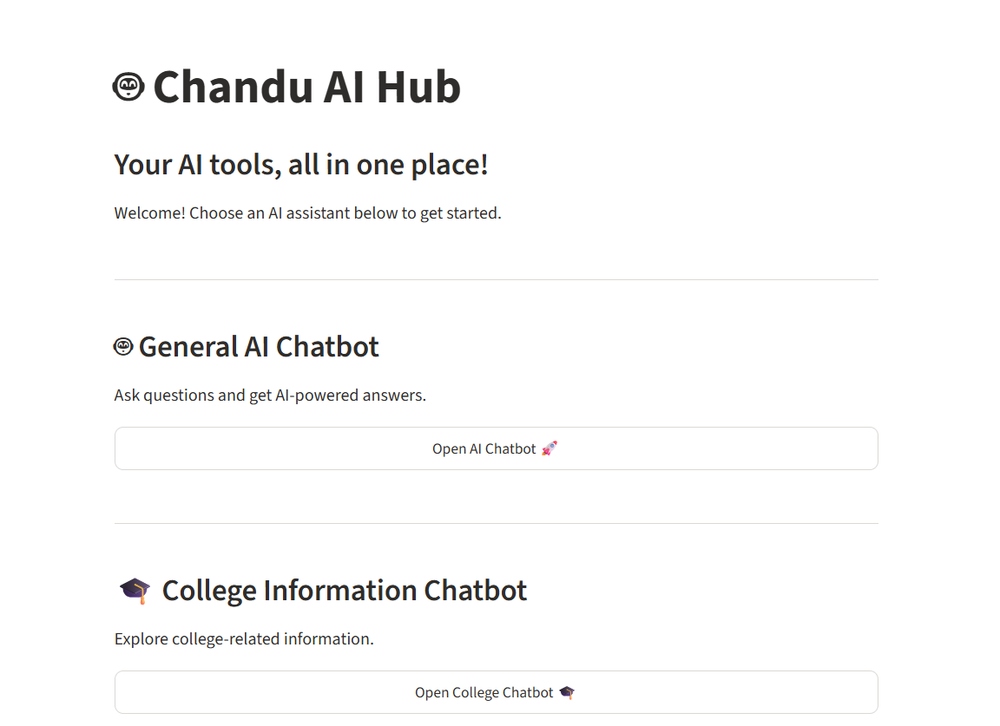
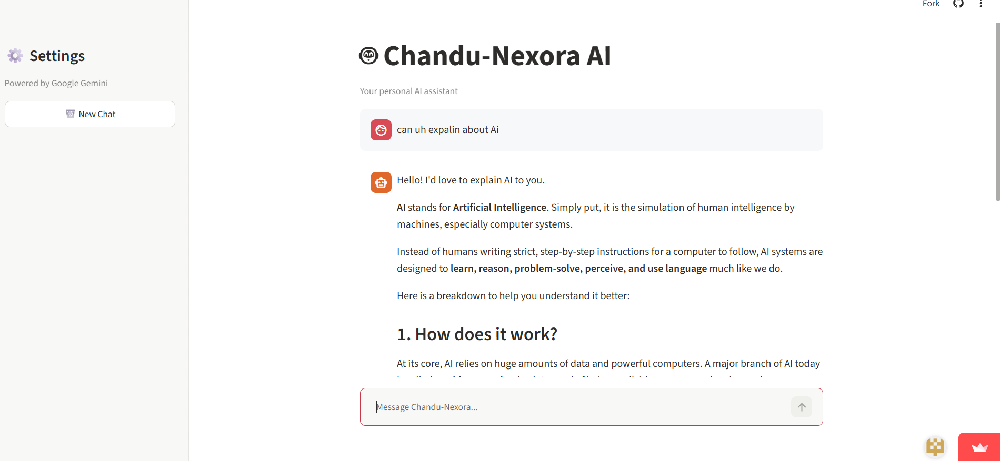

# 🤖 Nexora AI – Intelligent Conversational Chatbot

A web-based AI chatbot built using Python, Streamlit, and
Google Gemini API.

**Developed by Chandu Guthula**

🎓 B.Tech – Computer Science and Engineering
(Artificial Intelligence & Machine Learning)

## 🌐 Live Demo

Try Nexora AI:
https://chandu-nexora.streamlit.app/

## 📌 Project Overview

Nexora AI is a conversational chatbot prototype that
generates responses to user questions using Google's
Gemini API.

The application provides an interactive chat interface
and maintains conversation context to answer follow-up
questions.

This project was developed with AI-assisted coding
as part of hands-on learning in Python and Generative AI.

## ✨ Features

- AI-powered question answering
- Interactive Streamlit chat interface
- Context-aware follow-up conversations
- Chat history using Streamlit session state
- New Chat button to reset conversations
- Responses to educational and coding questions
- API key configuration using environment variables

## 🛠️ Technology Stack

| Technology | Purpose |
|---|---|
| Python | Application development |
| Streamlit | Web interface |
| Google Gemini API | AI response generation |
| Google Gen AI SDK | Model integration |
| python-dotenv | Local environment configuration |

## 🏗️ Architecture

User
  |
  v
Streamlit Chat Interface
  |
  v
Python Application
  |
  v
Conversation History
  |
  v
Google Gemini API
  |
  v
Generated AI Response
  |
  v
Streamlit Chat Interface

## 📂 Project Structure

Nexora-AI-Chatbot/
├── app.py
├── requirements.txt
├── README.md
└── .gitignore

## 🚀 Installation

### 1. Clone the Repository

git clone https://github.com/Ammisri2603/Nexora-AI-Chatbot.git

### 2. Open Project Folder

cd Nexora-AI-Chatbot

### 3. Install Dependencies

pip install -r requirements.txt

### 4. Configure Gemini API Key

Create a `.env` file locally:

GEMINI_API_KEY=your_api_key_here

Never upload the actual API key to GitHub.

### 5. Run the Application

streamlit run app.py

## 🧪 Testing

The chatbot has been manually tested for:

- General AI question answering
- Python example generation
- Contextual follow-up questions
- Resetting conversations using New Chat

## ⚠️ Known Limitations

- The Gemini API may occasionally return 503 errors
  when the selected model is overloaded.
- Chat history is stored in the current Streamlit session.
- The application is a learning prototype.

## 🔮 Future Improvements

- Better handling of temporary API failures
- More polished interface
- Additional chatbot capabilities
- Automated testing

## 👨‍💻 Developer

**Chandu Guthula**

B.Tech CSE – Artificial Intelligence & Machine Learning

GitHub:
https://github.com/Ammisri2603

## 📄 Project Status

Working prototype under active improvement

## 📸 Nexora AI Screenshots

### Chatbot Home Page

### AI Chatbot Conversation

